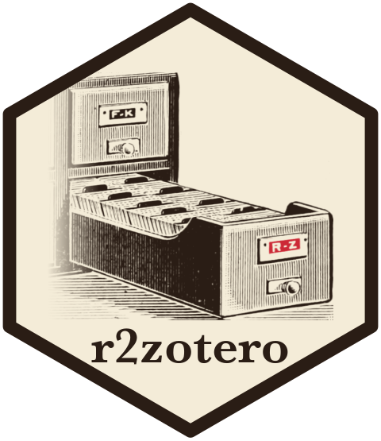

# r2zotero 

<!-- badges: start -->
  [](https://github.com/ethanbass/r2zotero/)
  [](https://github.com/emersion/stability-badges#experimental)
  [](https://ethanbass.r-universe.dev/r2zotero)
<!-- badges: end -->

**R2zotero** aims to facilitate citation of R packages by importing citations from an R package's 'CITATION' file directly to a local [Zotero](https://www.zotero.org/) 
library using the [Zotero Web API](https://www.zotero.org/support/dev/web_api/v3/start). 

## Installation

You can install the development version of r2zotero from [GitHub](https://github.com/) with:

``` r
# install.packages("pak")
pak::pak("ethanbass/r2zotero")
```

or from r-universe:

``` r
install.packages("r2zotero", repos="https://ethanbass.r-universe.dev/")
```

## Example

To send a citation to Zotero:

``` r
library(r2zotero)
r2zotero("lattice")
```

To cite several packages at once, pass a vector of names. To skip citations already in your Zotero library, add `skip_duplicates = TRUE`. This needs Zotero's local API, which you can turn on under Settings > Advanced > Allow other applications on this computer to communicate with Zotero.

``` r
# every attached package
r2zotero(names(sessionInfo()$otherPkgs))

# the packages a project's code loads
r2zotero(renv::dependencies()$Package)

# every package in an renv lockfile, including indirect dependencies
r2zotero(names(jsonlite::read_json("renv.lock")$Packages))
```

## Logo

The card catalog in the logo is an engraving from James Duff Brown's *Manual of Library Classification and Shelf Arrangement* (1898), via [Wikimedia Commons](https://commons.wikimedia.org/wiki/File:Card_catalog_from_page_167_of_%22Manual_of_library_classification_and_shelf_arrangement%22_(1898).jpg).
